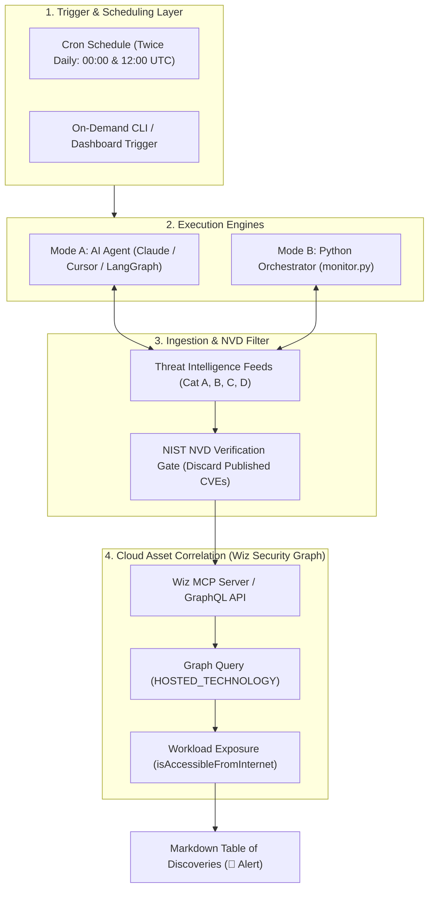

# Pre-Disclosure Cloud Threat Monitor — Initial Release

> [!IMPORTANT]
> **Disclaimer**: This software is an independent community project. It is **neither created by Wiz nor maintained by Wiz**. It is not an official product or service of Wiz, Inc.

An autonomous, multi-platform AI agent and monitoring toolkit that sweeps global threat intelligence feeds for **pre-disclosures and advance security advisories before official CVE publication in NVD**, correlates impacted technologies and versions against your live cloud workloads using the **Wiz Security Graph (via MCP / GraphQL)**, and generates an actionable **Table of Discoveries** prioritizing internet-exposed assets.

---

## Key Capabilities

* **Exhaustive Pre-Disclosure Ingestion (NVD Unconfirmed Rule)**:
  Filters out CVEs that are already published and confirmed in the National Vulnerability Database (NVD). Focuses strictly on advance security intelligence across all vendor and open-source ecosystems:
  - **Category A (Vendor & Ecosystem Advance Notices)**:
    - *Language Runtimes*: Node.js security pre-announcements, Go `golang-announce`, Python PSRT, Rust Security WG, OpenSSL upcoming security releases, Apache Software Foundation (Tomcat, HTTP Server, Kafka, Struts).
    - *Cloud, Containers & Hypervisors*: Kubernetes Distributor Pre-Disclosure List (`k8s-security-announce`), OCI/containerd/runc coordination, Xen Project (XSA), Broadcom / VMware PSIRT.
    - *Operating Systems & Linux Distros*: Openwall `oss-security`, `linux-distros` embargo list, Red Hat (RHSA) pre-coordination, Ubuntu (USN) `-proposed` queue, Debian Security Team, Microsoft MAPP & Patch Tuesday advance notices.
    - *Enterprise Edge & Network Appliances*: Cisco PSIRT upcoming releases calendar, F5 Networks Quarterly Security Notifications (QSN), Fortinet PSIRT, Palo Alto Networks PSIRT, Citrix NetScaler ADC/Gateway bulletins.
    - *Databases & Enterprise Infrastructure*: Oracle Critical Patch Update (CPU) pre-releases, PostgreSQL (PGDG) quarterly advance notices, MariaDB pre-disclosures.
    - *Hardware & Microarchitecture*: Intel Product Security Center (IPSRT) & AMD Product Security embargoes.
  - **Category B (Assigned CVEs in RESERVED State)**:
    - CVE.org and MITRE records where CVE IDs are assigned and under active coordinated vulnerability disclosure but unindexed on NVD.
  - **Category C (Staged Open-Source Fixes & Embargoed PRs)**:
    - Staged security commits, release branches, and pull requests awaiting coordinated embargo expiration.
    - *48 to 72 Hour Lead Time*: Attackers often reverse-engineer open-source git commits as soon as they hit public branches to build proof-of-concept exploits before downstream vendors release packages or NVD indexes the CVE.
    - *Proactive Exposure Mitigation*: Cloud and security engineering teams can apply compensatory controls (WAF rules, network security group restrictions, disabling affected modules) before the exploit is weaponized in the wild.
  - **Category D (Emerging 0-Days & Wiz Threat Research)**:
    - Real-time threat advisories and active campaign monitoring from Wiz Threat Center.
* **Zero-Credential Security**:
  Credentials never touch agent code, prompts, or commits. Uses standard environment variables and Model Context Protocol (MCP) authentication.
* **Deep Security Graph Workload Correlation**:
  Uses Wiz MCP (`execute_graph_query`) to query `HOSTED_TECHNOLOGY` entities across multi-cloud environments (AWS, Azure, GCP, OCI, Kubernetes).
* **Internet Exposure Triaging**:
  Automatically determines whether each host workload (VM, Container, Serverless) is internet-accessible (`isAccessibleFromInternet == true` / `isOpenToAllInternet == true`), prominently flagging exposed assets with `🚨 TRUE`.
* **Universal Portability**:
  Can run as an **MCP Agent** (Claude Desktop, Cursor, VS Code, LangGraph), a standalone **Python CLI/daemon**, a **Docker container**, or a **scheduled GitHub Actions workflow**.

---

## Comprehensive Threat Intelligence Matrix

| Technology Tier | Threat Intelligence Sources | Disclosure Mechanism & Notification Scope |
| :--- | :--- | :--- |
| **Language Runtimes** | Node.js Security, Go Announce, Python PSRT, Rust Security WG, OpenSSL | Advance release announcements (3–7 days ahead), impacted version lines, maximum severity ratings. |
| **Cloud & Containers** | Kubernetes SRC, containerd, runc, Xen XSA, VMware PSIRT | Private distributor pre-disclosure mailing lists, embargoed container escape coordination. |
| **Linux & Operating Systems** | Openwall `oss-security`, `linux-distros`, Red Hat RHSA, Ubuntu USN, Debian, Microsoft MAPP | Pre-release security errata queues, kernel security embargoes, partner early warning bulletins. |
| **Enterprise Edge & Gateways** | Cisco PSIRT, F5 Networks (QSN), Fortinet, Palo Alto Networks, Citrix NetScaler | Scheduled semi-annual/quarterly security notification drops, critical gateway RCE advance notices. |
| **Databases** | Oracle CPU Advance Notice, PostgreSQL PGDG, MariaDB | Quarterly advance releases, packager heads-up emails 1 week prior to public drops. |
| **Hardware / Firmware** | Intel IPSRT, AMD PSIRT | Multi-week coordinated microarchitectural side-channel embargoes with cloud hypervisors. |
| **Vulnerability Registries** | CVE.org, MITRE, GitHub Security Advisories (GHSA) | `** RESERVED **` CVE state tracking, coordinated disclosure drafts. |
| **Threat Research Centers** | Wiz Threat Center | Live 0-day exploitation tracking, emerging cloud threat advisories (`list_threat_advisory_items`). |

---

## Architecture & How the Loop Connects

The monitor can run in two primary execution modes: as an **Autonomous AI Agent** (Option 1) or as a **Deterministic Python Engine** (Options 2, 3, 4).



### Mode A: How the AI Agent Version Works (`mcp_agent_prompt.md`)

```
1. Global Threat Sweeping ──> Agent scans natural-language vendor notices, mailing lists & Wiz Threat Center
2. Semantic Extraction    ──> Agent extracts technology names & impacted version ranges from unstructured text
3. Cognitive NVD Filter   ──> Agent checks NVD; discards confirmed CVEs and retains true pre-disclosures
4. Dynamic MCP Execution  ──> Agent constructs & executes GraphQL queries via Wiz MCP (HOSTED_TECHNOLOGY)
5. Workload Triaging      ──> Agent inspects host entities, flags 🚨 TRUE for internet exposure & generates table
```

* **Cognitive Reasoning**: The agent (in Claude Desktop, Cursor, or LangGraph) reads messy human text, blog posts, and mailing lists natively without relying on rigid regex rules.
* **Semantic Normalization**: Automatically bridges vendor naming differences (e.g., recognizing `httpd` as `Apache HTTP Server`).
* **Out-of-Band Security**: The LLM directs the workflow and inspects graph results without ever viewing, possessing, or storing your Wiz API credentials (authentication is handled privately by the local MCP server).

### Mode B: How the Python Version Works (`monitor.py`)

```
1. Wiz Tenant Inventory  ──> Identifies running technologies in your cloud (e.g., Node.js, Apache)
2. Ecosystem Mapping    ──> Resolves canonical upstream repos and security branches (ecosystems.json)
3. GitHub & Feed APIs   ──> Checks staging branches, RSS/Atom feeds, and Wiz Threat Center
4. NVD Verification     ──> Queries NIST NVD REST API to ensure CVE is unconfirmed/unindexed
5. Wiz Graph Query      ──> Queries Wiz GraphQL and verifies if workloads are Internet-Exposed
```

* **Deterministic & Cost-Free**: Runs entirely via Python standard libraries and GraphQL without incurring AI model token fees.
* **Asset-Driven Targeting**: Focuses monitoring exclusively on the specific software technologies detected in your cloud tenant.
* **Headless Automation**: Designed for unattended cron jobs, lightweight Docker containers, or scheduled GitHub Actions workflows.

---

## Sample Output: Table of Discoveries

On each execution, the agent outputs a formatted Markdown report directly into your conversation, terminal, or CI/CD log:

| Pre-Disclosed Technology | Advisory / Origin | NVD Status | Impacted Workload Name | Resource Type | Cloud Platform | Detected Version | Internet Exposed? | Exposure Details | Associated Projects |
| :--- | :--- | :---: | :--- | :--- | :--- | :--- | :---: | :--- | :--- |
| **`<runtime-technology>`** | **`<Node.js / OpenSSL Advance Notice>`** | **Unpublished**<br>*(Pending drop)* | **`<workload-container-01>`** | Kubernetes Pod | **`<cloud-provider>`** (`<region>`) | `<version-x.y>` | 🚨 **TRUE** | Public ingress load balancer attached | `<project-name>` |
| **`<network-gateway>`** | **`<Cisco / F5 QSN Advance Bulletin>`** | **Unpublished**<br>*(Under Embargo)* | **`<workload-vm-02>`** | Virtual Machine | **`<cloud-provider>`** (`<region>`) | `<version-x.y>` | 🚨 **TRUE** | Public IP with open ingress route (`0.0.0.0/0`) | `<project-name>` |
| **`<database-technology>`** | **`<Oracle CPU / PostgreSQL Advance Notice>`** | **Pending NVD**<br>*(Unindexed in NVD)* | **`<workload-db-03>`** | Managed Database / VM | **`<cloud-provider>`** (`<region>`) | `<version-x.y>` | ⚪ **FALSE** | Private subnet / Internal VPC only | `<project-name>` |
| **`<hypervisor-technology>`** | **`<Xen XSA / Kubernetes Pre-Disclosure>`** | **RESERVED**<br>*(Under Embargo)* | *None (0 matching workloads)* | N/A | N/A | N/A | ⚪ **FALSE** | No matching infrastructure detected | N/A |

---

## Deployment Options

### Option 1: AI Agents via MCP (Claude Desktop, Cursor, VS Code, LangGraph)

1. Add the Wiz MCP server configuration to your tool config (e.g. `claude_desktop_config.json` or `.cursor/mcp.json`):
   ```json
   {
     "mcpServers": {
       "wiz": {
         "command": "npx",
         "args": ["-y", "@wiz-sec/mcp-server"],
         "env": {
           "WIZ_CLIENT_ID": "<your-wiz-client-id>",
           "WIZ_CLIENT_SECRET": "<your-wiz-client-secret>",
           "WIZ_AUTH_URL": "<your-wiz-auth-url>",
           "WIZ_API_URL": "<your-wiz-api-url>"
         }
       }
     }
   }
   ```
2. Copy the system prompt in `mcp_agent_prompt.md` into your agent instructions or project prompt.

---

### Option 2: Standalone Python Script / Cron Job

1. Install dependencies:
   ```bash
   pip install -r requirements.txt
   ```
2. Export your Wiz service account credentials securely via environment variables:
   ```bash
   export WIZ_CLIENT_ID="<your-wiz-client-id>"
   export WIZ_CLIENT_SECRET="<your-wiz-client-secret>"
   export WIZ_AUTH_URL="<your-wiz-auth-url>"
   export WIZ_API_URL="<your-wiz-api-url>"
   ```
3. Run on demand:
   ```bash
   python monitor.py
   ```
4. Set up a crontab to run twice daily (`00:00` and `12:00` UTC):
   ```cron
   0 0,12 * * * /usr/bin/python3 /path/to/monitor.py >> /var/log/pre-disclosure-monitor.log 2>&1
   ```

---

### Option 3: Docker & Container Deployment

Build and run containerized for local execution or cloud task scheduling (Kubernetes CronJob / AWS ECS / GCP Cloud Run):

```bash
# Using Docker
docker build -t pre-disclosure-monitor .
docker run --rm \
  -e WIZ_CLIENT_ID="<your-wiz-client-id>" \
  -e WIZ_CLIENT_SECRET="<your-wiz-client-secret>" \
  -e WIZ_AUTH_URL="<your-wiz-auth-url>" \
  -e WIZ_API_URL="<your-wiz-api-url>" \
  pre-disclosure-monitor

# Or with Docker Compose
docker compose run --rm pre-disclosure-monitor
```

---

### Option 4: GitHub Actions Scheduled Workflow

A turnkey workflow is provided in `.github/workflows/monitor.yml`.
1. Add `WIZ_CLIENT_ID`, `WIZ_CLIENT_SECRET`, `WIZ_AUTH_URL`, and `WIZ_API_URL` to your repository's GitHub Secrets (**Settings > Secrets and variables > Actions**).
2. The workflow automatically executes every 12 hours (`0 0,12 * * *`) and logs the discoveries.

---

## Security & Credential Isolation

* **Least Privilege Scopes**: The Wiz Service Account only requires:
  - `read:resources` (inspect workload entities)
  - `read:security_scans` / `read:sbom_artifacts` (read package and library versions)
  - `read:projects` (map findings to organizational teams)
* **Zero Secret Persistence**: No credentials are ever saved in Git or passed in prompt text. All access is resolved at runtime through environment variables.

---

## Disclaimer

This software is an independent open-source project. It is **neither created by Wiz nor will it be maintained by Wiz**. All product names, logos, and brands (including Wiz) are property of their respective owners. Use of these names does not imply any affiliation with, endorsement by, or maintenance commitments from Wiz, Inc.

---

## License

Licensed under the [Apache License, Version 2.0](LICENSE).
